# CHAPTER SIX {.cover}

::: {.subtitle-line}
Tree-based methods: Decision trees for regression and classification
:::

- Module code: **EC4308**
- Module title: **Machine Learning and Economic Forecasting**
- Instructor: **Vu Thanh Hai**
- Reference: ISLR = *An Introduction to Statistical Learning*, Ch. 8.1 (R packages: `tree`, `rpart`)
- *Acknowledgement: I adapt Dr. Denis Tkachenko's notes with some minor modifications. Thanks to Denis!*

# Lecture outline

1. Introduction and overview of the main ideas.
2. Decision trees and the CART algorithm.
3. Choosing tree size.
4. Classification trees: loss functions and performance measures.
5. Concluding remarks.

# 1) Introduction

- So far, we have stayed within the familiar parametric model framework: estimating linear regressions with various regularizations.
- Although some of the models fitted could be classified as nonparametric (e.g., polynomial series whose degree grows with the sample size), we still wrote down the models in terms of a vector of parameters.
- Today we will talk about methods that belong to the realm of *nonparametric estimation*.

# 1) Introduction {#intro-2}

- Specifically, we discuss the so-called *regression trees* and related methods, which are widely used in data science applications: CART (classification and regression trees), BART (Bayesian additive regression trees), MARS (multivariate adaptive regression splines), random forests… This chapter covers CART; ensemble methods come later.
- "Of all the well-known learning methods, decision trees come closest to meeting the requirements for serving as an off-the-shelf procedure for data mining." (Hastie et al., 2009, *The Elements of Statistical Learning*, ESL)
- These methods are also quickly gaining traction in the econometric literature related to both prediction and causal inference.
- Trees can handle both regression and classification problems.

# 1) Introduction {#intro-3}

- One could say: "But I've never heard of this stuff – what is there to gain over the usual regression-based methods?"
- **Preview of pros:** flexible, needs no standardization of the data, selects variables, computationally efficient, scales up well, interpretable.
- **Preview of cons:** simple trees will likely lose out to other methods on prediction and do not naturally lead to continuous models; ensembles of trees (bagging, boosting, random forests) improve prediction but at the cost of interpretability.

# 2) Decision tree

```{=html}
<svg viewBox="0 0 720 230" width="78%" style="display:block;margin:0 auto 0.4em" role="img" aria-label="Umbrella decision tree: wake up, then split on the chance of rain and on the sky">
  <style>
    .n rect{fill:#6aa84f;rx:4} .n text{fill:#fff;font:600 15px sans-serif;text-anchor:middle}
    .l rect{fill:#C00000;rx:4} .l text{fill:#fff;font:600 15px sans-serif;text-anchor:middle}
    path{fill:none;stroke:#6aa84f;stroke-width:2}
  </style>
  <path d="M80 100 L150 30 M80 100 L150 170 M240 30 L300 30 M240 170 L300 130 M240 170 L300 205 M390 130 L440 95 M390 130 L440 160 M530 95 L570 95 M530 160 L570 160 M390 205 L440 205"/>
  <g class="n"><rect x="10" y="82" width="90" height="36"/><text x="55" y="105">Wake up</text></g>
  <g class="n"><rect x="150" y="12" width="90" height="36"/><text x="195" y="35">&gt; 70% rain</text></g>
  <g class="n"><rect x="150" y="152" width="90" height="36"/><text x="195" y="175">&lt; 70% rain</text></g>
  <g class="n"><rect x="300" y="112" width="90" height="36"/><text x="345" y="135">&gt; 30% rain</text></g>
  <g class="n"><rect x="300" y="187" width="90" height="36"/><text x="345" y="210">&lt; 30% rain</text></g>
  <g class="n"><rect x="440" y="77" width="90" height="36"/><text x="485" y="100">Cloudy</text></g>
  <g class="n"><rect x="440" y="142" width="90" height="36"/><text x="485" y="165">Sunny</text></g>
  <g class="l"><rect x="300" y="12" width="100" height="36"/><text x="350" y="35">Umbrella</text></g>
  <g class="l"><rect x="570" y="77" width="110" height="36"/><text x="625" y="100">Umbrella</text></g>
  <g class="l"><rect x="570" y="142" width="110" height="36"/><text x="625" y="165">No umbrella</text></g>
  <g class="l"><rect x="440" y="187" width="110" height="36"/><text x="495" y="210">No umbrella</text></g>
</svg>
```

- Basic logic: use a series of steps to reach a decision (ideally, we combine mini-decisions into good choices).
- Each decision (green box) is a *node*. The first node is called the *root node*.
- The final decision (red box) is a *leaf node* (or a *leaf*).

# 2) Regression tree idea

::: {.tiny}
*Hitters data (ISLR Ch. 8; middle and right panels: Figs. 8.2 and 8.1): predict $y=\log(\text{Salary})$ of baseball players from Years and Hits. Left: color = salary (cool colors low, warm colors high). Middle: regions $R_1$–$R_3$. Right: the tree; leaf values are mean log salary.*
:::

:::: {.columns .short}
::: {.column width="33%"}
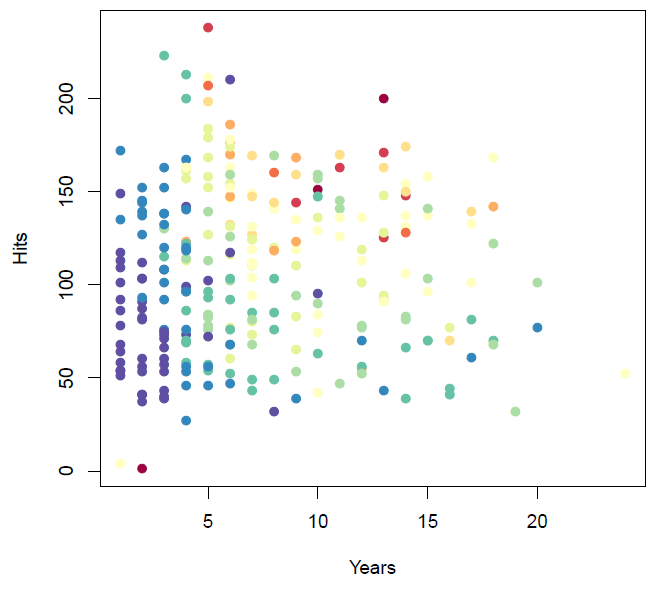{width="100%"}
:::
::: {.column width="33%"}
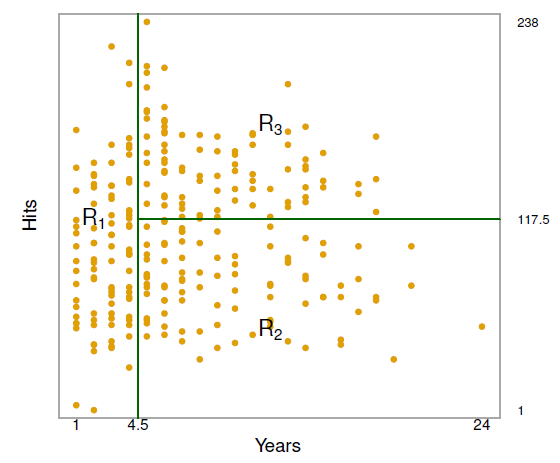{width="100%"}
:::
::: {.column width="33%"}
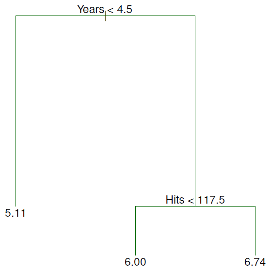{width="100%"}
:::
::::

Overall, the tree stratifies or segments the players into three regions of predictor space:

$$\begin{aligned}
R_1&=\{X \mid \text{Years}<4.5\}, \qquad R_2=\{X \mid \text{Years}\ge 4.5,\ \text{Hits}<117.5\},\\
R_3&=\{X \mid \text{Years}\ge 4.5,\ \text{Hits}\ge 117.5\}.
\end{aligned}$$

# 2) Regression tree idea {#idea-2}

- A regression tree partitions the covariate space into a set of rectangles and then fits a simple model (a constant) in each one.
- The function is constant on each rectangle; that constant is estimated by the average outcome in the rectangle:

$$\hat f(x)=\sum_{m=1}^{M} \hat c_m\, 1(x\in R_m), \qquad \hat c_m=\operatorname{ave}(y_i \mid x_i\in R_m).$$

# 2) Regression tree idea {#idea-3}

:::: {.columns}
::: {.column width="30%"}
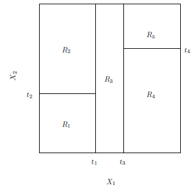{width="100%"}
:::
::: {.column width="70%"}
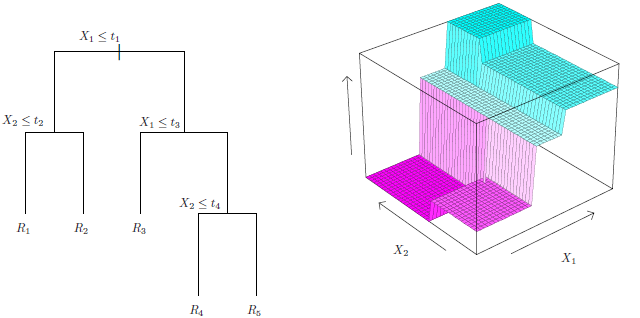{width="100%"}
:::
::::

::: {.tiny}
*Partition into boxes $R_1$–$R_5$ (left), the tree that produces it (middle), and the fitted step surface (right). Source: ESL Fig. 9.2.*
:::

# 2) Regression tree idea {#idea-4}

- Ideally, for a fixed number $M$ of boxes, we would choose the partition $(R_1,\dots,R_M)$ to minimize (where $\hat y_{R_m} \equiv \hat c_m$ is the mean of $y$ in $R_m$):

$$\sum_{m=1}^{M}\ \sum_{i:\,x_i\in R_m}\left(y_i-\hat y_{R_m}\right)^2.$$

- Problem: finding the best partition is computationally infeasible. We cannot enumerate all possible trees, i.e., all combinations of a first split and lower-level splits.
- Thus, we use a *greedy* method: make the best split at each step, without looking ahead.

# 2) Building a tree: CART

- Main idea: form the tree using *recursive* binary partitions of the data.
- **Step 1:** define $R_1(j,c)=\{X \mid X_j<c\}$ and $R_2(j,c)=\{X \mid X_j\ge c\}$, and choose the predictor $j$ and cut-point $c$ to solve

$$\min_{j,\,c}\ \sum_{i:\,x_i\in R_1(j,c)}\left(y_i-\hat y_{R_1}\right)^2+\sum_{i:\,x_i\in R_2(j,c)}\left(y_i-\hat y_{R_2}\right)^2,$$

  where $\hat y_{R_k}$ is the forecast of $y$ based on data in region $R_k$ (usually the sample mean of $y$ in that region).

# 2) Building a tree: CART {#cart-2}

- **Step 2:** Split the data into the two subregions from Step 1. Repeat the splitting process for each subregion, taking the split that minimizes the squared loss. Keep iterating this step.
- **Step 3:** Stop when the stopping criterion allows no further split (e.g., every split must leave at least 5 observations in each child node).

# 2) Building a tree: Boston data

- Boston data: `medv` (median home value) on `lstat` (% lower-status population) only; pruned to 7 leaves, the size cross-validation (CV) picks in Section 3.

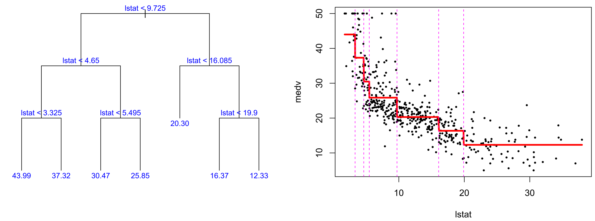{width="84%" fig-align="center"}

- At each interior node, we go left if $x<c$, right if $x\ge c$.
- Each observation goes down the tree until it reaches a leaf.
- The leaves give a partition of $X$-space into disjoint regions.

# 2) Building a tree: Boston data {#boston-2}

{width="84%" fig-align="center"}

- The resulting fitted function is just a step function with steps given by the tree partition.
- To make a prediction, find the interval to which the new observation belongs and set the forecast equal to the sample mean of that region.

# 2) Building a tree: Boston data {#boston-3}

:::: {.columns}
::: {.column width="44%"}
- Consider an additional predictor $x_2=$ `dis` (weighted mean of distances to five Boston employment centers). Again pruned to 7 leaves.
- We can see how the $X$-space is partitioned.
- Notable feature: automatic interaction detection (in this fitted tree, `dis` is used only in some ranges of `lstat`).

::: {.guide}
Reading guide: `dis` is used in three of the four `lstat` bands, but not for $9.725\le$ `lstat` $<16.085$ (leaf 20.3). In this fitted tree the effect of `dis` depends on `lstat`: suggestive of an interaction, found without being told.
:::
:::
::: {.column width="56%"}
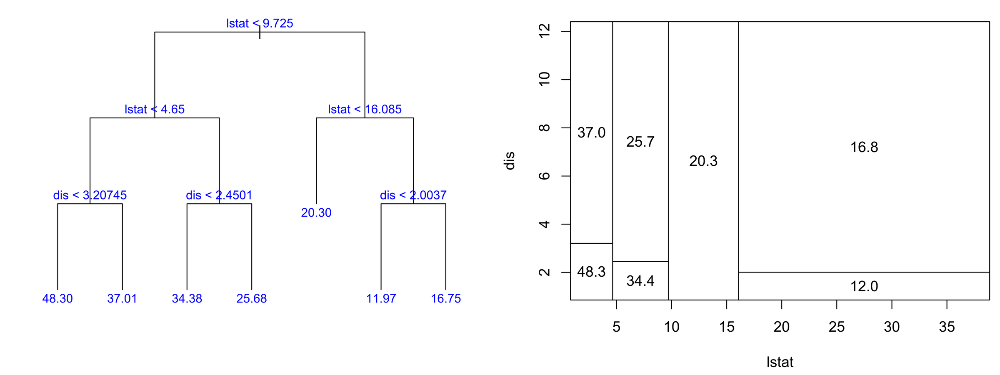{width="100%"}
:::
::::

# 2) Building a tree: Boston data {#boston-4}

- The estimated function is again a step function with steps given by the tree partition (one plateau per leaf):

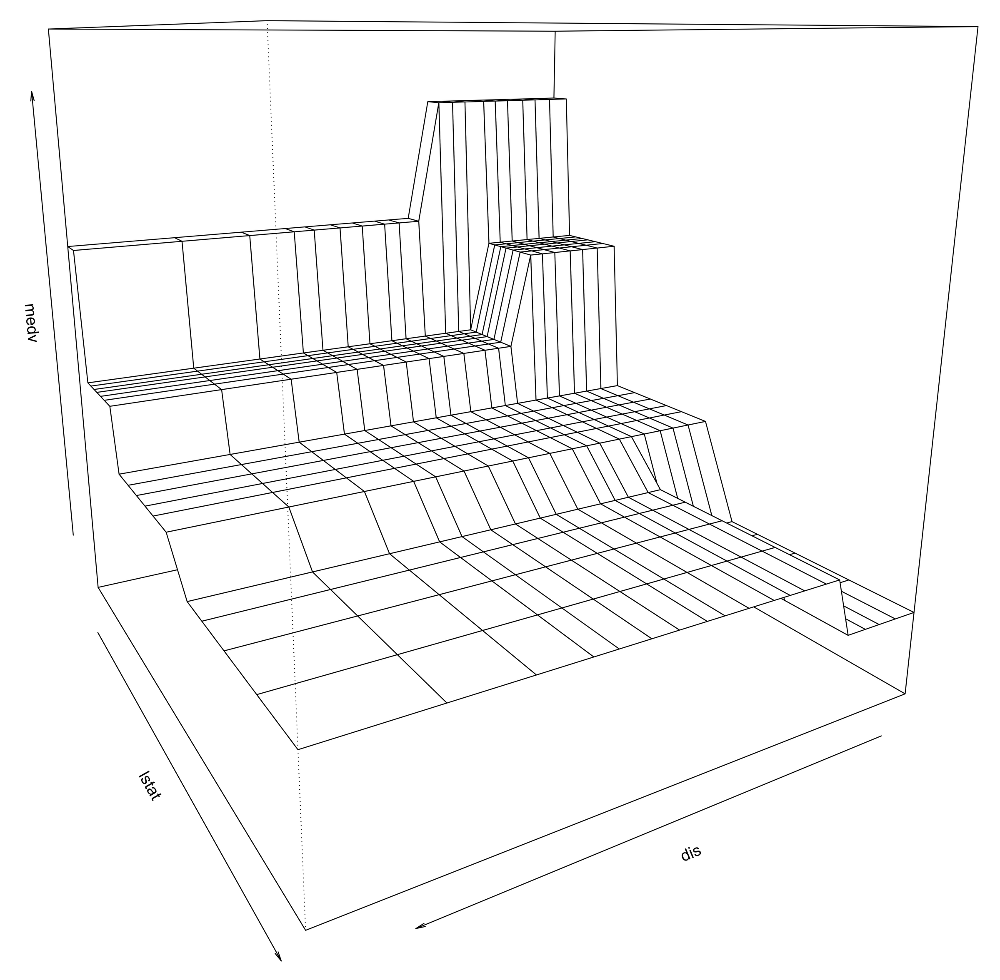{width="44%" fig-align="center"}

# 2) Boston data: big tree

- Big tree for just `lstat` (`tree` package, `mindev = 0.0001`): a node is split only if its deviance is at least 0.0001 × the root node's deviance; each child keeps at least 5 observations. The labels are unreadable by design: this tree is far too big and chases noise.

:::: {.columns .short}
::: {.column width="50%"}
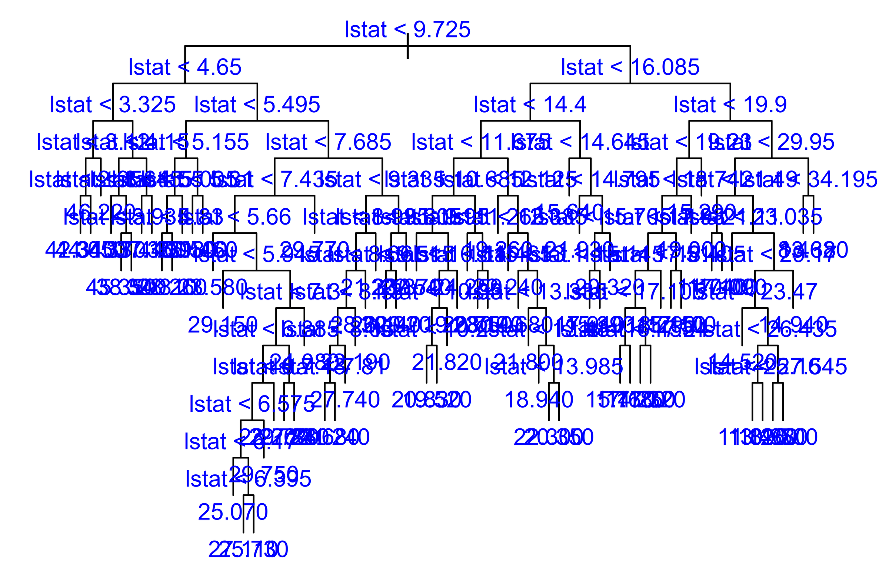{width="100%"}
:::
::: {.column width="50%"}
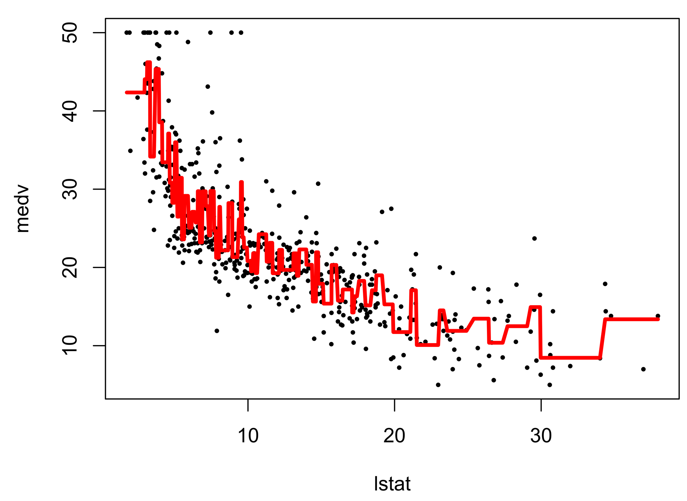{width="100%"}
:::
::::

# 2) Building a tree: 401(k) example

- Data: 1991 Survey of Income and Program Participation (SIPP), $N=9{,}915$. We try to predict 401(k) eligibility.
- In Section 4, trees are fit on a training sample of 8,000 and evaluated on the remaining 1,915 (test sample).
- List of predictors: income, age, schooling, family size, married dummy, male dummy, two-earner household dummy.
- Such a classification model could be used to estimate propensity scores for studying the effect of 401(k) eligibility on wealth (e.g., Belloni et al., 2014, who use Lasso; modern causal ML uses random forests or Double ML).
- Since eligibility is a binary variable, predicting it is a *classification* problem (its splitting criteria come in Section 4).

# 2) 401(k) data: simple tree

- For a simple tree with depth $\le 4$ fit on all 9,915 observations, leaves show the predicted class and counts of <span style="white-space:nowrap">$y=0$ / $y=1$</span>:

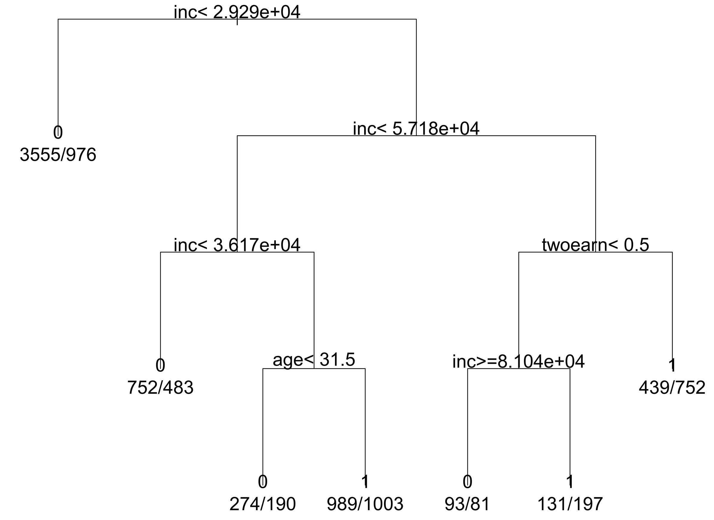{width="66%" fig-align="center"}

::: {.tiny}
*`rpart` draws the branch where the printed condition holds on the left (e.g., `inc>=8.104e+04`).*
:::

# 2) 401(k) data: big tree

- Now allow depth $\le 30$.

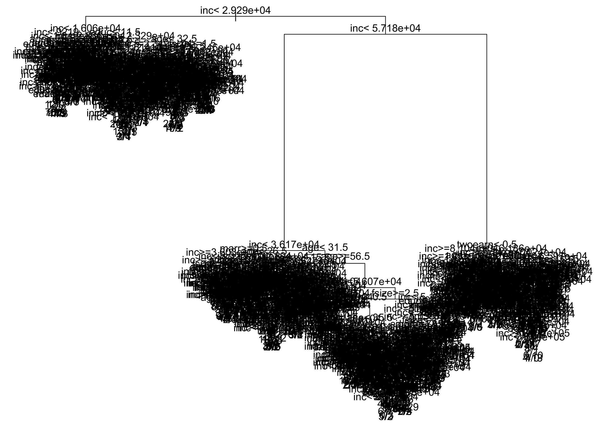{width="62%" fig-align="center"}

- Do we need all 985 leaves (labels unreadable by design)? See Sections 3–4.

# 2) A quick summary on trees

- Trees partition the predictor space using recursive binary splits.
- Each split consists of a decision rule that sends $x_i$ left or right.
- For a numeric predictor $X_j$, the rule is based on the threshold $X_j<c$.
- For a categorical predictor $X_j$, the rule lists the set of categories sent left.

# 2) A quick summary on trees {#summary-2}

- The set of leaves gives a partition of the $X$-space.
- For prediction, we let the observation $x_i$ follow the path dictated by the splitting rules down the tree until it reaches a leaf:
  - for a continuous outcome, the prediction is the sample mean of $y$ in that node;
  - for a categorical outcome, it is based on the category proportions of the training data in that node (e.g., the predicted category is the majority category in that node).

# 2) A quick summary on trees {#summary-3}

:::: {.columns}
::: {.column width="64%"}
- Handles categorical (few levels) and numeric $X$ and $Y$ well.
- No need to worry about the scale of the $X$'s.
- Computationally efficient (can scale up well).
- Does well in some cases where linear regression does not.
- Smaller trees are very interpretable.
- Performs automatic interaction detection.
- Does variable selection.
:::
::: {.column width="36%"}
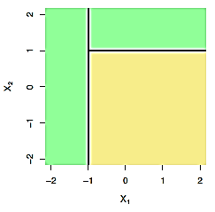{width="92%"}

::: {.tiny}
*True classes: shading. The tree recovers the rectangular true boundary with two splits; a linear boundary cannot. Source: ISLR Fig. 8.7.*
:::
:::
::::

# 2) A quick summary on trees: problems

:::: {.columns}
::: {.column width="64%"}
- The step function a tree fits is crude and may not give the best predictive performance, e.g., it struggles with a linear relationship.
- Does not handle categorical variables well when there are a lot of categories (most other methods don't either, however).
- Big/deep trees lose interpretability.
- Unstable: a changed early split alters the whole tree below it.
:::
::: {.column width="36%"}
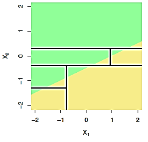{width="92%"}

::: {.tiny}
*True boundary is linear: the tree needs a staircase of splits. Source: ISLR Fig. 8.7.*
:::
:::
::::

# 3) Choosing tree size

- A tree is just a type of flexible model that we fit to data.
- As with other nonparametric or high-dimensional models, increased complexity will result in better in-sample fit – the key question is *how to restrict it*.
- For trees, the usual measure of complexity is the number of leaves or terminal nodes.
- Too many leaves = overfitting! Easy to fall into this trap.
- For best prediction performance, we will need to manage the *bias/variance tradeoff*, as usual.

# 3) Choosing tree size: minimization problem

- Tree choice can be represented as a minimization problem over subtrees $T$ of a big initial tree, with penalized objective $Q(T,y)$:

$$\hat T_\alpha=\arg\min_T Q(T,y)=\arg\min_T\ \Big[L(T,y)+\alpha|T|\Big]$$

- Here $L(T,y)$ is a loss function of using the tree $T$ to forecast $y$: usually the residual sum of squares (RSS). With squared loss:

$$\hat T_\alpha=\arg\min_T\ \sum_{m=1}^{|T|}\sum_{i:\,x_i\in R_m}\left(y_i-\hat y_{R_m}\right)^2+\alpha|T|.$$

- $|T|$ is the number of leaves – a measure of tree complexity.
- $\alpha$ is the "penalty" parameter that performs regularization. It plays the role of $\lambda$ in penalized regression fitting.
- If $\alpha=0$, we would keep the full big tree, which overfits the data. We need to choose $\alpha$ carefully: it is the key tuning choice.

# 3) Choosing tree size: minimization problem {#size-2}

- How do we actually perform the minimization?
- The idea behind the trees is simple, but trees are large and complex when viewed as a variable in an optimization problem.
- The key to success here is a simple algorithm: *cost-complexity pruning (weakest link pruning)*.
- Breiman et al. (1984) showed that for each $\alpha$ there is a unique smallest subtree of the big tree minimizing the objective function, and that pruning finds it exactly.

# 3) Minimization algorithm

- **Stage 1:** *Grow big.* Grow a big tree first by recursive binary splitting, with a stopping criterion (e.g., at least 5 observations in each child node).
- Rationale: we want to grow big initially, because a seemingly worthless split high in the tree may really play an important role lower down. So we let the data, not our prior beliefs, decide which early splits are worth keeping.

# 3) Minimization algorithm {#algo-2}

- **Stage 2:** *Prune back.* Recursively prune back the big tree from Stage 1: at each step, collapse the internal node whose removal gives the smallest increase in loss *per leaf removed* (the "weakest link").
- This gives a nested sequence of subtrees of the big tree that is guaranteed to contain $\hat T_\alpha$ for every value of the penalty.
- For a given $\alpha$, choose the subtree that has the smallest $Q(T,y)$.

::: {.guide}
Weakest link: for an internal node $t$ with branch $T_t$, let $L(t)$ be the loss if $t$ is collapsed to a leaf and $L(T_t)$ the loss of its branch. The increase in loss per leaf removed is $g(t)=\dfrac{L(t)-L(T_t)}{|T_t|-1}$. For example, collapsing a 3-leaf branch ($|T_t|=3$) with loss 20 to a leaf with loss 50 gives $g(t)=\frac{50-20}{3-1}=15$. Collapse the node with the smallest $g(t)$, then repeat; the successive values of $g$ are the $\alpha$'s at which the optimal subtree changes.
:::

# 3) Choice of $\alpha$

- The remaining (most important) step is to choose $\alpha$ from the data.
- Not much surprise here: the usual approach is $K$-fold cross-validation (CV). In each fold, grow and prune on the training part and compute the error on the held-out part; pick the $\alpha$ with the lowest average CV error.

# 3) Simple example: Boston data

:::: {.columns}
::: {.column width="36%"}
- Simple example with `lstat` only.
- Perform 10-fold CV.
- Y-axis: 10-fold mean squared error (MSE) relative to the sample mean fit vs. transformed $\alpha$ on the X-axis (`cp` $=\alpha$ divided by the RSS of the root; `cp` falls to the right, so trees grow).

::: {.guide}
Top axis: tree size. CV error falls steeply up to about 3 leaves, is lowest at about 7, then creeps back up: bigger trees fit noise. Bars: ±1 standard error (SE); dotted line: minimum + 1 SE (the "1-SE rule", not used here, would pick a smaller tree).
:::
:::
::: {.column width="64%"}
::: {.tall}
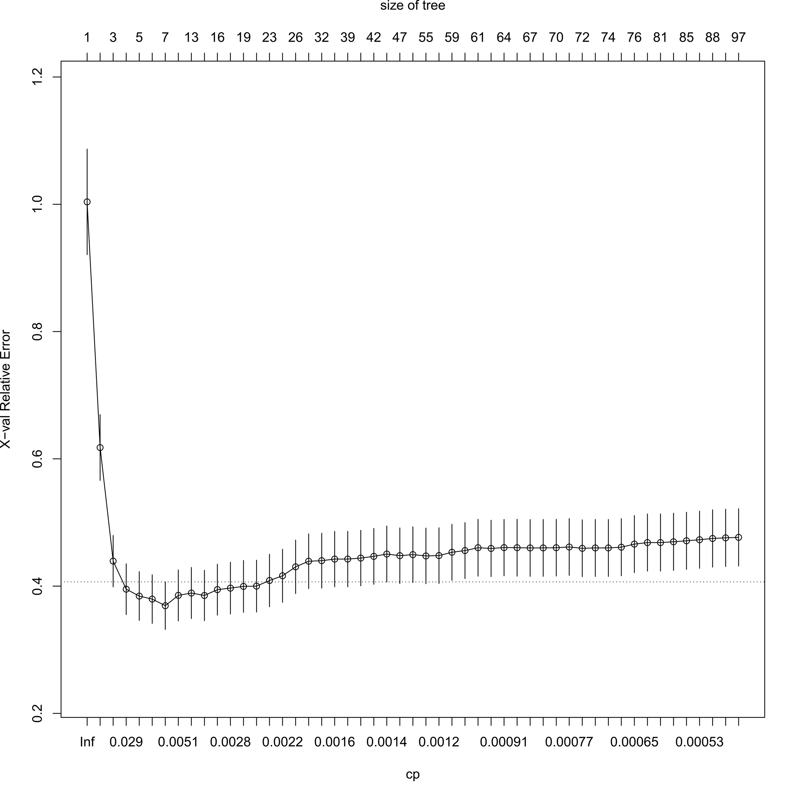{width="100%"}
:::
:::
::::

# 3) Simple example: Boston data {#cv-2}

:::: {.columns}
::: {.column width="40%"}
- Three examples of tree fits for different $\alpha$.
- Smaller $\alpha$ implies a smaller penalty on complexity and hence a bigger tree.
- Note the nesting: each smaller tree is a subtree of the bigger one.
- The middle tree has the CV-minimizing $\alpha$.
:::
::: {.column width="60%"}
::: {.tall}
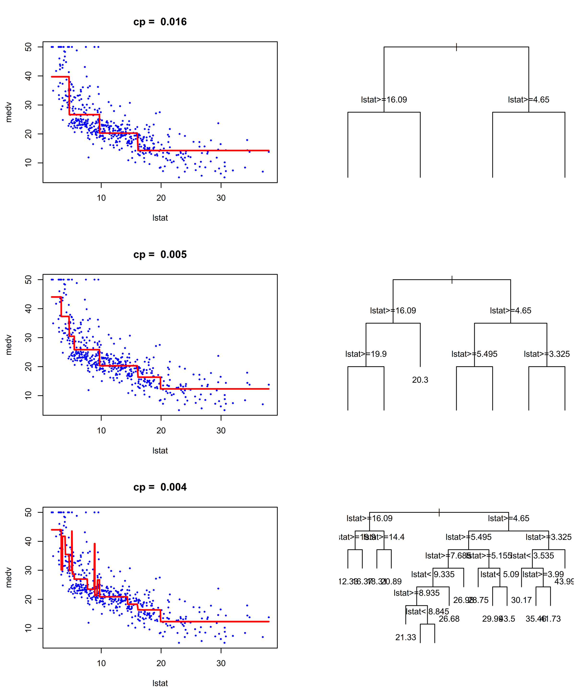{width="100%"}
:::
:::
::::

# 3) Simple example: Boston data {#cv-3}

:::: {.columns}
::: {.column width="30%"}
- CV-minimizing tree:

::: {.guide}
The same 7-leaf tree as in Section 2. Here `rpart` put the condition `lstat` $\ge c$ on the left branch (the lower-mean child), so the tree appears mirrored.
:::
:::
::: {.column width="70%"}
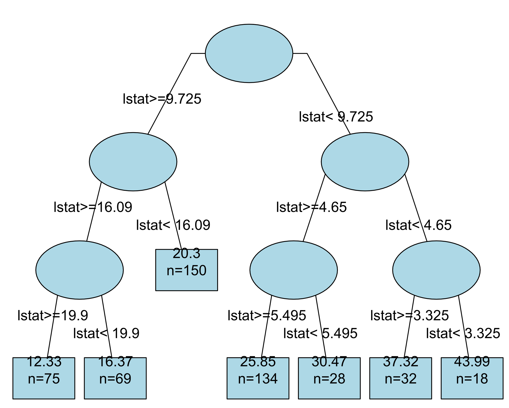{width="96%"}
:::
::::

# 3) Interactive: prune a big tree with $\alpha$ {.companion-only}

<iframe src="tree-demo.html" width="100%" height="560" style="border:none;" title="Interactive regression tree: grow a big tree, then prune it with cost-complexity alpha"></iframe>

# 4) Loss function for classification trees

:::: {.columns}
::: {.column width="64%"}
- Let us come back to the classification problem.
- MSE is less natural here – we use a different loss.
- Let the loss function be
$L(T,y)=\sum_{m=1}^{|T|}N_m\,L_m(y_m)$.
- $m$ indexes terminal nodes in tree $T$; $N_m$ is the no. of obs. in terminal node $m$; $y_m$ is the vector of outcomes for obs. in node $m$; $L_m$ is the node loss (next slide).
- Let $R_m$ denote the region of $X$ corresponding to node $m$, and $\hat p_{mk}=\frac{1}{N_m}\sum_{i:\,x_i\in R_m}1(y_i=k)$, $k=1,\dots,K$.
- Observations in node $m$ are classified to $k(m)=\arg\max_k \hat p_{mk}$.
:::
::: {.column width="36%"}
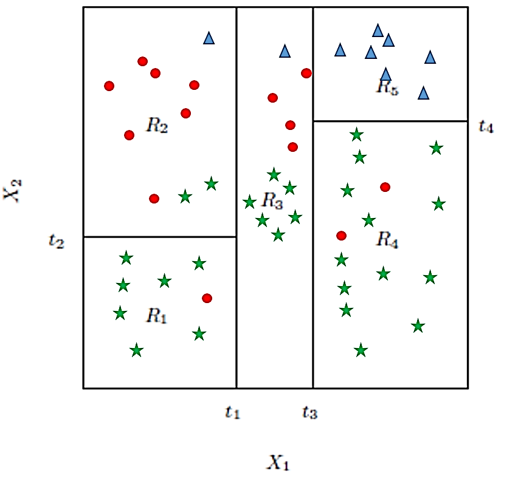{width="100%"}

::: {.tiny}
*Adapted from ESL Fig. 9.2.*
:::
:::
::::

# 4) Common loss functions (classification)

:::: {.columns}
::: {.column width="64%"}
Choices for the node loss $L_m$:

- **Misclassification error:** $\dfrac{1}{N_m}\sum_{i:\,x_i\in R_m}1\big(y_i\ne k(m)\big)=1-\hat p_{m,k(m)}$
  - binary case: $1-\max\{p,\,1-p\}$, with $p$ the proportion with $y=1$.
- **Gini index:** $\sum_{k=1}^{K}\hat p_{mk}(1-\hat p_{mk})$; binary case: $2p(1-p)$.
- **Cross-entropy or deviance** (negative log-likelihood): $-\sum_{k=1}^{K}\hat p_{mk}\log\hat p_{mk}$; binary case: $-p\log p-(1-p)\log(1-p)$.
- Some also use squared loss (MSE) for a binary $y$.

::: {.guide}
Worked example (binary node, natural log): $p=0.2$ gives misclassification $0.2$, Gini $2(0.2)(0.8)=0.32$, entropy $\approx 0.50$; at $p=0.5$ all three peak ($0.5$, $0.5$, $\log 2\approx0.69$).
:::
:::
::: {.column width="36%"}
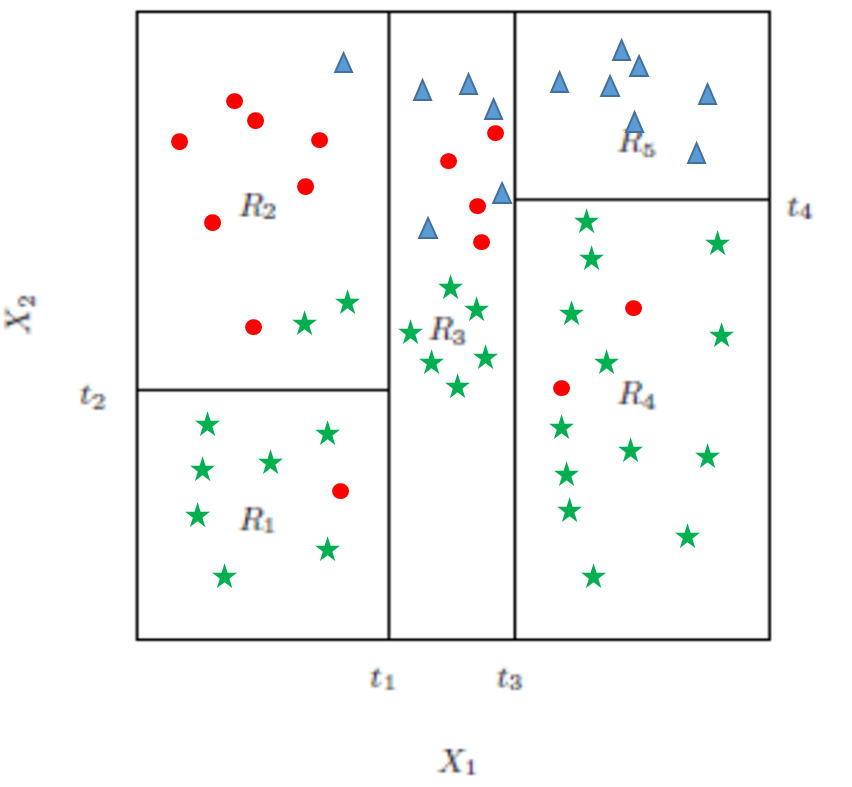{width="100%"}

::: {.tiny}
*Adapted from ESL Fig. 9.2.*
:::
:::
::::

# 4) Interactive: grow a classification tree, watch Gini and cross-entropy fall {.companion-only}

Two interleaved classes; CART picks the split that most reduces weighted impurity. Step through the splits and switch the criterion between **Gini** and **Cross-entropy** to see how recursive partitioning isolates regions. Lower *min. obs. per leaf* to watch the boundary overfit and train error collapse — an intuition for pruning (covered in Section 3).

<iframe src="classifier-demo.html" width="100%" height="560" style="border:none;" title="Interactive classification tree: recursive splitting and Gini vs cross-entropy impurity"></iframe>

# 4) Common loss functions: comments

- Misclassification error is not differentiable and is relatively insensitive to changes in node probabilities, so it is not recommended for growing the tree.
- Gini interpretation: error rate for a rule that assigns each observation to outcome $k$ with probability $\hat p_{mk}$. In the binary case, it equals $2p(1-p)$, twice the variance of the 0/1 outcome in the node.
- Typically, Gini or deviance is used for growing the tree.
- Any of the three losses can then be used for cost-complexity pruning; misclassification is the usual choice.

# 4) R packages: *tree* and *rpart*

- Two main tree packages in R: *tree* and *rpart*.
- Neither allows all the options discussed above. Syntax and display of output differ, so "shop around" between the two depending on what you are doing.
- *tree* syntax: `tree.fit <- tree(y ~ x, data = df, control = tree.control(...))`
- *rpart* syntax: `tree.fit <- rpart(y ~ x, data = df, control = rpart.control(...))`
- Full details are in the code, as usual.

# 4) Classification: 401(k) eligibility

:::: {.columns}
::: {.column width="36%"}
- CV-min Gini tree:

::: {.guide}
CV-min = CV-minimizing. Grown with Gini (`rpart`); CV error is the misclassification rate. Fit on the training sample (8,000 obs.). Each leaf shows the predicted class, then the counts of <span style="white-space:nowrap">$y=0$ / $y=1$</span>.
:::
:::
::: {.column width="64%"}
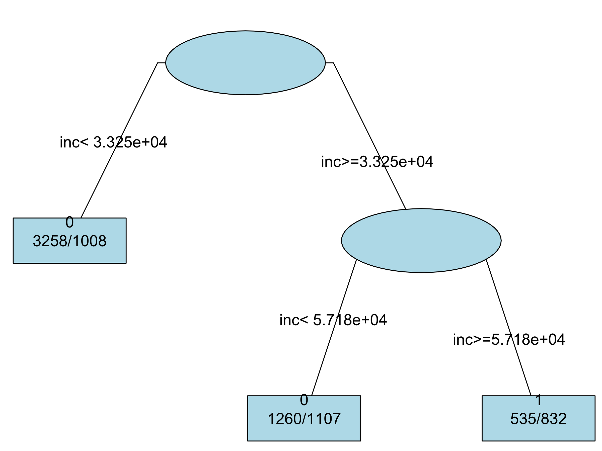{width="92%"}
:::
::::

# 4) Classification: 401(k) eligibility {#k401-2}

:::: {.columns}
::: {.column width="36%"}
- CV-min deviance tree (not unique; the smallest is shown):

::: {.guide}
Grown and CV-pruned on deviance (`tree` package). Both leaves of the left split predict 0: the split makes the nodes purer (lower deviance) without changing the predicted class.
:::
:::
::: {.column width="64%"}
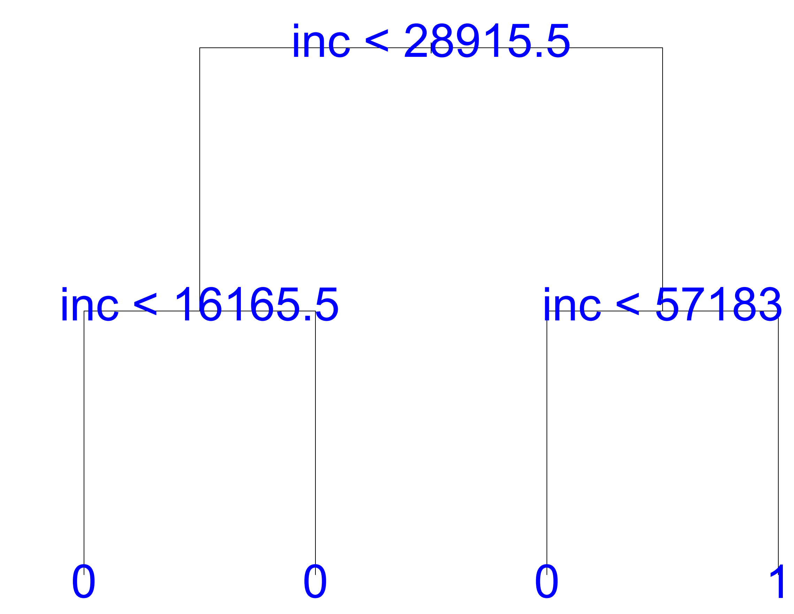{width="85%"}
:::
::::

# 4) Classification: 401(k) eligibility {#k401-3}

:::: {.columns}
::: {.column width="36%"}
- CV-min squared loss tree:

::: {.guide}
Grown and CV-pruned on squared loss (`rpart`, anova). Leaves show the share with $y=1$ and the node size. Classify 1 if the share exceeds 0.5: only the rightmost leaf.
:::
:::
::: {.column width="64%"}
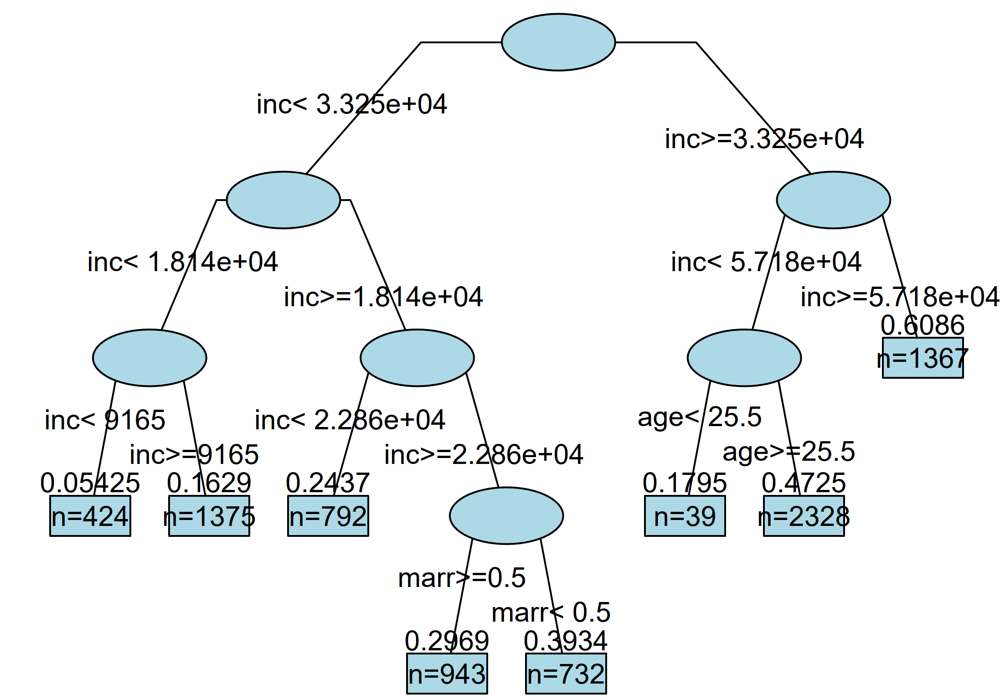{width="94%"}
:::
::::

# 4) Test-set performance: trees vs. logit

- All three trees give the same 0/1 rule (predict 1 if income is above about \$57,000), so they make identical test-set predictions.
- For reference, we also fit a logit model using the same variables; its results are in parentheses.
- Test-set errors: trees 665/1,915 (logit 651; predicting 0 for everyone 735):

::: {.compact-table}
|               |       | Actual 0    | Actual 1   |
|---------------|:-----:|:-----------:|:----------:|
| **Predicted** | **0** | 1052 (1059) | 537 (530)  |
|               | **1** | 128 (121)   | 198 (205)  |
:::

# 4) Performance measures for classification

- There is a lot of work on classification problems and, as a result, a lot of confusing jargon.
- Below are some common terms you may encounter.
- **Confusion matrix** = matrix of predicted vs. actual values:

::: {.compact-table}
|               |       | Actual 0 (TN / FP) | Actual 1 (FN / TP) | Total |
|---------------|:-----:|:------------------:|:------------------:|:-----:|
| **Predicted** | **0** | 1052 (TN)          | 537 (FN)           | 1589  |
|               | **1** | 128 (FP)           | 198 (TP)           | 326   |
| **Total**     |       | 1180               | 735                | 1915  |
:::

- **Lift (cumulative gains):** summary of prediction performance comparing % of true positives (TP) to % classified as 1 (N).
- **ROC** (Receiver Operating Characteristic): summary of prediction performance comparing % of true positives (TP) to % of false positives (FP).

# 4) Performance measures for classification {#perf-2}

- Lift and ROC assess $\hat p(x)$ via predictions $\hat y=1\big(\hat p(x)>s\big)$ as $s$ varies ($s$ is the cut-off; the score is the share of 1s in the leaf of $x$).
- TP (true positives): % of $y=1$ correctly classified. FP (false positives): % of $y=0$ incorrectly classified. N: % classified as 1.
- All three quantities go from 1 to 0 as $s$ goes from 0 to 1:

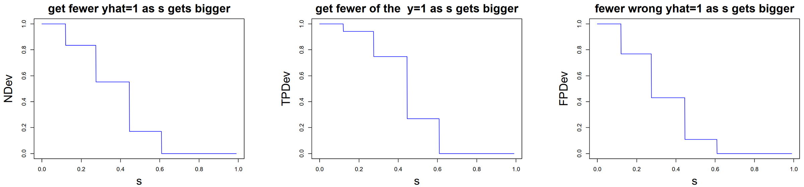{width="76%" fig-align="center"}

::: {.guide}
Worked point (deviance tree, test data, $s=0.5$): <span style="white-space:nowrap">TP $=198/735=0.27$,</span> <span style="white-space:nowrap">FP $=128/1180=0.11$,</span> <span style="white-space:nowrap">N $=326/1915=0.17$:</span> the first kinks of the next slide's curves. (NDev, TPDev, FPDev = N, TP, FP.)
:::

# 4) Lift and ROC

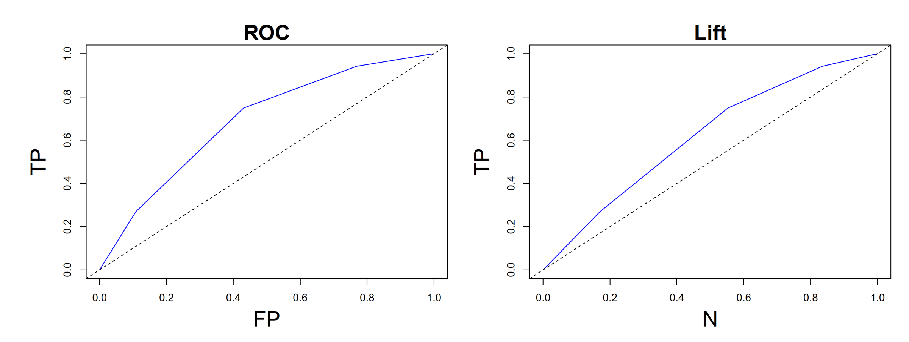{width="70%" fig-align="center"}

- ROC plots TP against FP.
- Lift (also called a cumulative gains chart) plots TP against N: at the same share classified as 1, higher TP is better.
- $s$ is decreasing as we move from left to right in each plot.
- The 45-degree line represents random guessing (a score unrelated to $y$).
- Sometimes we use the area under the curve (AUC) to summarize overall performance. Higher AUC is better.

# 4) Lift in 401(k) data

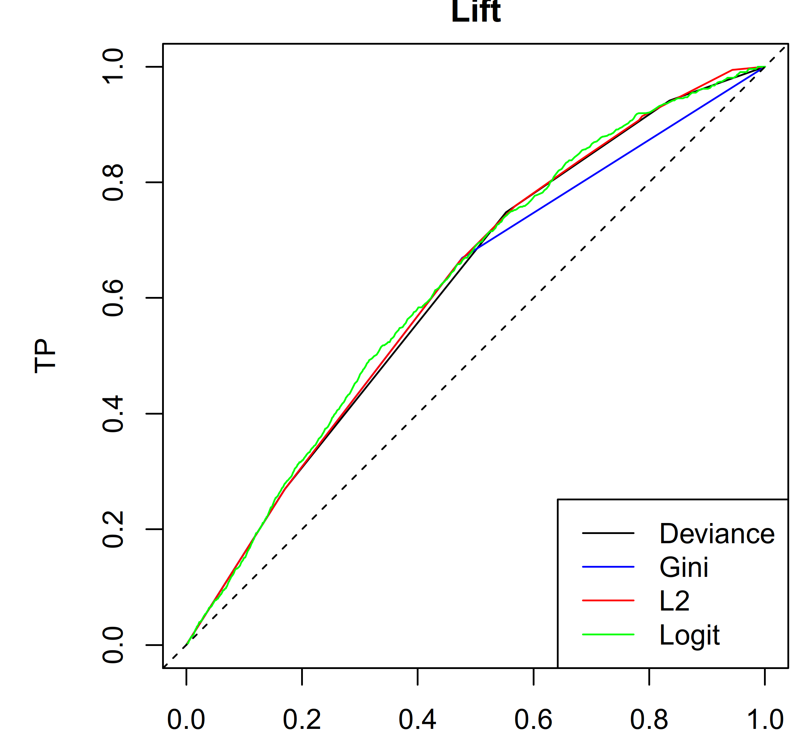{width="44%" fig-align="center"}

- Deviance, L2 (squared loss) and logit nearly coincide; Gini is coarser.

# 5) Concluding remarks

- Tree-based methods provide a benchmark in many modern machine learning / big data settings.
- Small trees are simple to interpret, scalable, and give reasonable (if rarely the best) predictions "off-the-shelf".
- They perform variable selection and detect nonlinearities and interactions *without careful user specification*.
- In the 401(k) example, the CV-pruned trees (3–8 leaves) all reduce to a single decision rule—predict 1 if $\text{income} \gtrsim \$57{,}000$—yielding 665/1,915 test errors (vs. 651 for logit and 735 for predicting 0).
- They may underperform in prediction in their basic form; tree size is typically chosen by CV-based pruning.
- They may be unstable: a small change in data can result in a large change in the estimated tree. *Next: bagging and random forests reduce this instability; boosting mainly improves accuracy.*
